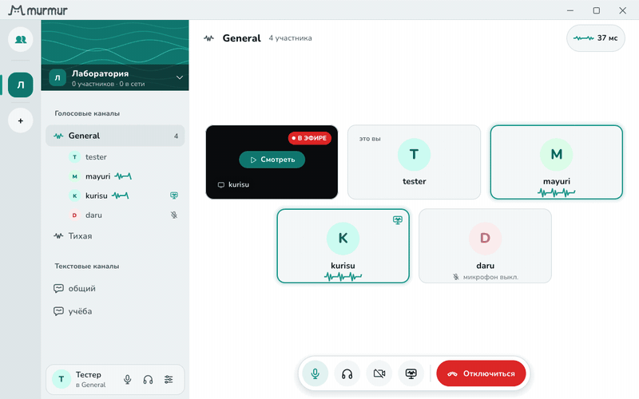
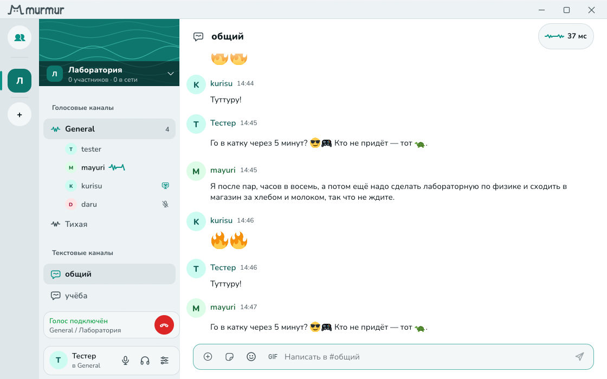
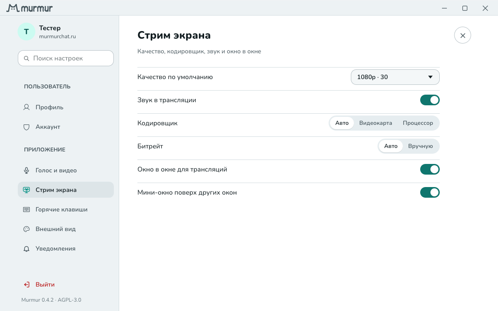

# Murmur

**English** · [Русский](README.md)

**Native Rust voice, chat & screen-sharing messenger. Self-host in one command.**

Murmur is a Discord-style app for friends, gaming squads and small teams — voice channels, text chat, friends and DMs, group calls — built around one thing most chat apps do badly: **sharing your screen or a single window, with that app's sound, in real quality.**

<p align="center"></p>

<p align="center">
  
  
</p>

<sub>Screenshots are from the built-in demo mode with test data.</sub>


## Why Murmur

- **Native client, no Electron.** Rust + wgpu, a single Windows .exe (installer ≈ 35 MB). In idle it uses ≈180 MB of RAM versus ≈1 GB for Discord (6 processes; measured on Windows 11, 2026-11-23). <!-- ЗАМЕР: в голосе и при просмотре стрима — дописать -->
- **Real screen sharing.** Share a whole screen or one window, up to 1080p/1440p at 60 fps and native resolution, hardware-encoded on your GPU (NVENC / AMF / QuickSync). The sound of *only that app* is shared too (per-process audio capture), not the whole system mix.
- **Remote control of a shared screen — on request.** A viewer can ask the streamer for control; the streamer allows or denies it, sees a "being controlled" indicator, and can take control back at any moment. Pointer-only mode is available too. Discord has nothing like it.
- **Built for bad networks.** TURN over TLS/443 for networks that block UDP, an economy layer for viewers on weak links, fast reconnect without leaving the channel. A built-in F3 overlay shows RTT, bitrate, fps, packet loss and the encoder in use.
- **Clean voice.** Local neural noise suppression (DeepFilterNet), echo cancellation, per-user volume, push-to-talk and global hotkeys that work from inside a game.
- **Everything you expect from a chat.** Text channels, roles and permissions, invites, friends, DMs with unread counters, group calls with camera (up to 8), reactions, emoji, stickers, GIF search (proxied through your server — clients never talk to a third party), Windows notifications, Do Not Disturb that turns on during a stream.
- **Private by design.** No ads, no telemetry. Images are re-encoded on the server (EXIF stripped). Update packages are signed (ed25519).
- **Zero-hassle self-hosting.** One script brings up LiveKit, Caddy (automatic HTTPS) and the backend (Rust + SQLite — no database server to manage). See below.
- **Free to host, free to use.** Your own server has no limits at all. We also run an official instance; paid plans there (higher stream quality and bigger files for large communities) are planned, nothing is paywalled on self-hosted servers. AGPL-3.0.

## Status

Windows client only for now (Linux later). Used daily by a small group of friends; expect rough edges — please report bugs in Issues.

## Self-hosting

Ubuntu 22.04/24.04 or Debian 12 (x86-64, 1 GB RAM+), root over SSH. Run on the server:

```sh
curl -fsSL https://raw.githubusercontent.com/Zenden1982/murmur/main/deploy/install.sh | sudo sh
```

The installer sets up Docker, LiveKit, Caddy (HTTPS) and the backend, then prints the server address (enter it in the client's login screen) and an invite for your friends. A domain is optional — without one it uses free `sslip.io` names. Details (ports, updates, backup) are in the [Russian guide](README.md#установка-своего-сервера).

## License

AGPL-3.0.
