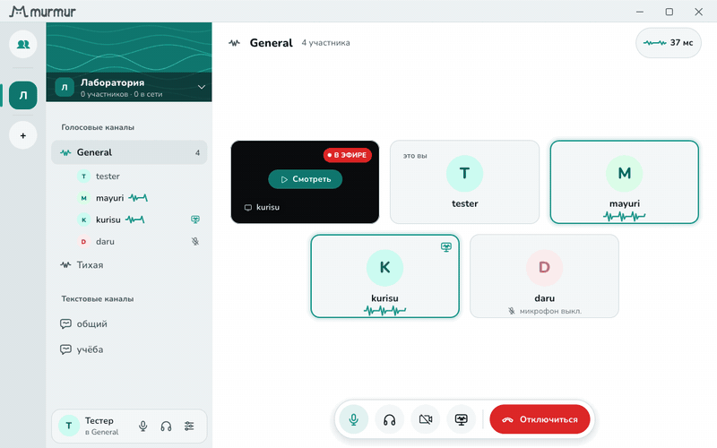
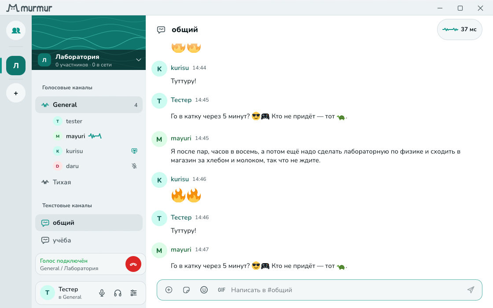

<h1 align="center">&nbsp;Murmur</h1>
<p align="center"><b>Voice, chat and screen sharing with sound — on your own server.<br>You can even let a friend take the controls of your computer. The server installs with one command.</b></p>
<p align="center"><b>English</b> · <a href="README.ru.md">Русский</a> · <a href="#self-hosting">Self-hosting</a> · <a href="https://github.com/Zenden1982/murmur/releases">Download</a></p>

<p align="center"></p>

<p align="center">
  
  
</p>
<p align="center"><sub>Screenshots are from the client's demo mode, the data is fake.</sub></p>

I'm building Murmur for myself and my friends, so we can talk, play and show each other our screens without depending on someone else's service: the server is yours, and so is the data. It has voice channels, text, friends and DMs, but the main point is what it was all started for: **screen sharing** that is easy on both the streamer and the viewers.

## Screen sharing

You can share your **whole screen** — the computer's sound goes along with it (except Murmur itself, to avoid echo). Or you can share **a single app**: viewers see only that window and hear only that program. Music in another tab or chat notifications stay out of the stream.

Quality goes up to 1440p at 60 fps or your monitor's native resolution. Video is encoded by the GPU, so it barely affects a game. If a viewer's connection is weak they can turn on an economy mode, and if your ISP blocks UDP everything falls back to TLS on port 443. Press F3 for an overlay with ping, bitrate, fps and packet loss — handy for finding out what's lagging.

## Remote control

Think AnyDesk, but inside the call, with no extra software. A viewer clicks "Ask for control" and **the streamer decides**: refuse, allow a pointer only (the viewer shows with a cursor where to look), or allow full mouse and keyboard control.

While someone is in control the streamer sees a "being controlled by …" badge, and can take control back at any moment with the "Take back" button or Ctrl+Alt+Space. You can only control what is being shared — the window or the screen, not the whole computer at once. Useful for helping a parent with their PC, going through settings together, or showing a newcomer how something works.

## What else

- **A light client, no Electron.** Written in Rust, a single Windows .exe, installer ≈ 35 MB. Idle, it takes about 180 MB of RAM; Discord on my machine in the same state takes about 1 GB (six processes; measured on Windows 11, 2026-11-23). <!-- ЗАМЕР: в голосе и при просмотре стрима — дописать -->
- **Decent voice.** Local neural noise suppression (DeepFilterNet), echo cancellation, per-user volume, push-to-talk and global hotkeys that work from inside a game.
- **Chat.** Text channels, roles and permissions, invites, friends, DMs, group calls with camera for up to 8 people, reactions, emoji, stickers, GIF search (requests go through your server, clients never talk to third parties), Windows notifications and a Do Not Disturb that turns itself on while you stream.
- **Privacy.** No ads, no telemetry. Images are re-encoded on the server and stripped of metadata. Client updates are signed.
- **Your own server.** One script sets up LiveKit, Caddy (HTTPS is automatic) and a Rust backend with SQLite — no database server to run. Your own server has no limits.
- **Later.** There may eventually be an official server with paid plans for large communities (higher stream quality, bigger files). It won't restrict anything on your own server. AGPL-3.0.

## Status

For now it's a Windows client only; Linux comes later. Right now I and a few friends use Murmur every day, so rough edges happen — if something breaks, open an issue.

## Self-hosting

Ubuntu 22.04/24.04 or Debian 12 (x86-64, 1 GB RAM+), root over SSH. Run on the server:

```sh
curl -fsSL https://raw.githubusercontent.com/Zenden1982/murmur/main/deploy/install.sh | sudo sh
```

The installer sets up Docker, LiveKit, Caddy (HTTPS) and the backend, then prints the server address (enter it in the client's login screen) and an invite for your friends. A domain is optional — without one it uses free `sslip.io` names. Details (ports, updates, backup) are in the [Russian guide](README.ru.md#установка-своего-сервера).

## License

AGPL-3.0.
