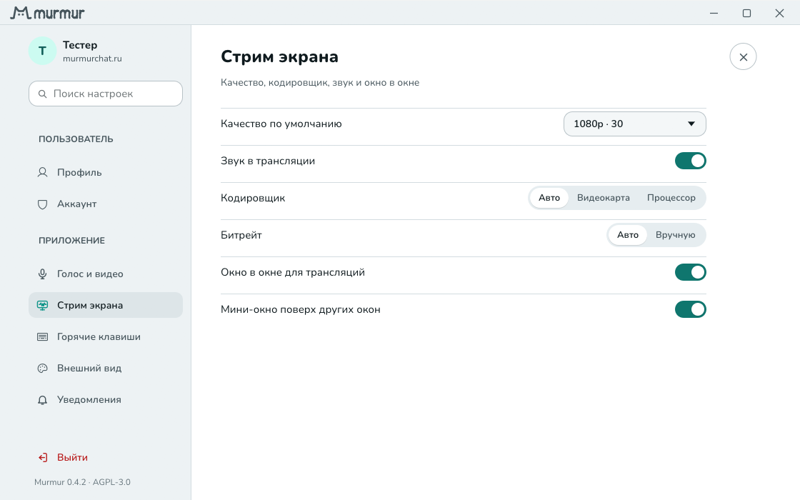

<h1 align="center">&nbsp;Murmur</h1>
<p align="center"><b>Голос, чат и показ экрана со звуком — на вашем собственном сервере.<br>Можно даже дать другу порулить вашим компьютером. Сервер ставится одной командой.</b></p>
<p align="center"><a href="README.en.md">English</a> · <b>Русский</b> · <a href="#установка-своего-сервера">Установка сервера</a> · <a href="https://github.com/Zenden1982/murmur/releases">Скачать клиент</a></p>

<p align="center"></p>

<p align="center">
  
  
</p>
<p align="center"><sub>Скриншоты из демо-режима клиента, данные тестовые.</sub></p>

Я делаю Murmur для себя и друзей — чтобы можно было спокойно поговорить, поиграть и показать друг другу экран, не завися от чужих сервисов: сервер ваш, данные ваши. В нём есть голосовые каналы, текст, друзья и личные сообщения, но главное — то, ради чего всё затевалось: **показ экрана**, который не мучает ни стримера, ни зрителей.

## Показ экрана

Можно показать **весь экран** — тогда в трансляцию уходит звук компьютера (кроме самого Murmur, чтобы не было эха). А можно показать **одну программу**: зрители видят только это окно, и слышно тоже только эту программу. Музыка в другой вкладке или уведомления мессенджера в трансляцию не попадут.

Качество — до 1440p при 60 кадрах в секунду или в родном разрешении монитора. Видео кодируется видеокартой, так что игре это почти не мешает. Если у зрителя слабый интернет, он может включить экономный режим; а если провайдер режет UDP, всё пойдёт через TLS по порту 443. По F3 открывается оверлей с пингом, битрейтом, кадрами и потерями — удобно искать, из-за чего всё тормозит.

## Удалённое управление

Это похоже на AnyDesk, только прямо внутри звонка, без отдельных программ. Зритель нажимает «Попросить управление», а **стример сам решает**: отказать, дать только указку (зритель показывает курсором, куда смотреть) или разрешить полное управление мышью и клавиатурой.

Пока кто-то управляет, у стримера висит плашка «Тобой управляет …», а забрать управление можно в любой момент — кнопкой «Забрать» или сочетанием Ctrl+Alt+Пробел. Управлять можно только тем, что вы показываете: окном или экраном, но не всем компьютером сразу. Удобно, когда надо помочь родителям с компьютером, вместе разобраться с настройками или что-то быстро показать новичку.

## Что ещё есть

- **Лёгкий клиент без Electron.** Написан на Rust, один .exe для Windows, установщик ≈ 35 МБ. В простое занимает около 180 МБ памяти, а Discord у меня в том же состоянии — около 1 ГБ (шесть процессов; замер на Windows 11, 2026-11-23). <!-- ЗАМЕР: в голосе и при просмотре стрима — дописать -->
- **Нормальный голос.** Локальный нейросетевой шумодав (DeepFilterNet), эхоподавление, громкость каждого участника отдельно, рация и глобальные горячие клавиши, которые работают прямо из игры.
- **Чат.** Текстовые каналы, роли и права, инвайты, друзья, личные сообщения, групповые звонки с камерой до 8 человек, реакции, эмодзи, стикеры, поиск GIF (запросы идут через ваш сервер, клиенты ни к кому постороннему не обращаются), уведомления Windows и «Не беспокоить», который сам включается во время трансляции.
- **Приватность.** Ни рекламы, ни телеметрии. Картинки на сервере перекодируются, метаданные удаляются. Обновления клиента подписаны.
- **Свой сервер.** Один скрипт ставит LiveKit, Caddy (HTTPS сам) и бэкенд на Rust с SQLite — отдельную базу данных поднимать не надо. На своём сервере нет никаких лимитов.
- **Дальше.** Позже, возможно, появится официальный сервер с тарифами для больших сообществ (качество стрима повыше, файлы побольше). На своих серверах это ничего не ограничит. Лицензия AGPL-3.0.

## Статус

Пока есть только клиент для Windows, Linux — потом. Сейчас Murmur каждый день используют я и несколько друзей, так что шероховатости бывают — если что-то сломалось, напишите в Issues.

## Установка своего сервера

Сервер Murmur — три сервиса в Docker (голос и видео LiveKit, Caddy с сертификатами, бэкенд с аккаунтами и чатом).
Ставится одной командой, готовые образы скачиваются с ghcr.io, на сервере ничего не собирается.

### Что нужно

- VPS с **Ubuntu 22.04 / 24.04** или **Debian 12**, архитектура x86-64, от 1 ГБ памяти.
- Доступ по SSH с правами root (или sudo).
- Свой домен **не обязателен**: без него установщик использует бесплатные имена по IP вида `api.85-12-34-56.sslip.io`.

### Установка

Зайдите на сервер по SSH и выполните:

```sh
curl -fsSL https://raw.githubusercontent.com/Zenden1982/murmur/main/deploy/install.sh | sudo sh
```

Установщик спросит:

1. **Домен.** Enter — без домена (имена sslip.io по IP). Если вводите свой, заранее создайте три A-записи
   `lk.`, `turn.` и `api.` на IP сервера (например, `lk.chat.example.com`); установщик дождётся, пока они заработают.
2. **Почту** для Let's Encrypt. Можно пропустить.
3. **Ник и пароль администратора.**

Дальше он сам поставит Docker, создаст ключи, откроет порты в ufw (если он включён) и запустит сервер.
Установка идёт несколько минут. В конце на экране будут:

- **адрес сервера** — его вписывают в клиент Murmur на экране входа;
- **инвайт** для друзей (по умолчанию на 10 человек, действует 7 дней).

Всё ставится в `/opt/murmur`.

### Порты

Если у хостера есть свой firewall (панель провайдера), откройте входящие:

| Порт | Зачем |
|---|---|
| 443/tcp | HTTPS, API и подключение к LiveKit |
| 7881/tcp | медиа LiveKit по TCP |
| 7882/udp | медиа LiveKit по UDP |
| 3478/udp | TURN |

### Управление: команда `murmur`

| Команда | Что делает |
|---|---|
| `murmur invite [--uses N] [--hours H]` | новый инвайт (по умолчанию 10 человек, 7 дней) |
| `murmur update` | обновить до последней версии; перед этим делается копия базы, настройки и ключи сохраняются |
| `murmur update --domain chat.example.com` | перейти на свой домен; прежний адрес `…sslip.io` продолжит работать |
| `murmur backup` | копия базы данных |
| `murmur status` | состояние сервера и проверка обновлений |
| `murmur logs` | журналы |

Повторный запуск установочной команды тоже обновляет сервер, ничего не стирая.

### Установка без вопросов

Для автоматизации:

```sh
curl -fsSL https://raw.githubusercontent.com/Zenden1982/murmur/main/deploy/install.sh \
  | sudo sh -s -- --yes --admin <ник> --admin-password-file <файл с паролем> [--domain <домен>] [--email <почта>]
```

### Обновления клиента

Свой сервер не хранит выпуски клиента: номер новой версии он берёт у официального сервера
(`UPDATES_UPSTREAM`, по умолчанию `https://api.murmurchat.ru`), а за файлом отправляет клиентов туда же.
Если новому клиенту нужен более свежий сервер, клиенты не увидят это обновление, пока вы не выполните `murmur update`.
Чтобы отключить, задайте пустое `UPDATES_UPSTREAM=` в `/opt/murmur/.env` и перезапустите сервер (`murmur update`).

### Вручную через docker compose

Для тех, кто не хочет запускать скрипт: те же файлы лежат в [`deploy/`](deploy/) (`docker-compose.yml`, `render.sh`,
`.env.example`). Подробности и другие схемы (за своим reverse proxy, без доступа к Docker Hub) — в [deploy/README.md](deploy/README.md).

## Лицензия

AGPL-3.0, см. [LICENSE](LICENSE).
